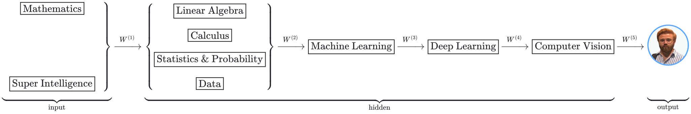

<!--
  Kemal Kılıçaslan — GitHub profile README
  Theme  : Super Intelligence Developer (mathematics, AI → linear algebra, calculus, statistics & probability, data → ML → DL → CV)
  Palette: kemalkilicaslan.com dark theme · bg #0D1117 · surface #161B22 · hover #21262D · border #30363D
           text #C9D1D9 · muted #8B949E · accent #58A6FF  (dark tones only, in both GitHub themes)
  Badges : assets/badge/*.svg (brand logos kept, right panel = dominant logo color)
-->

## About

I graduated from Kastamonu University with a degree in Mathematics in 2022, and since then I have been applying that background to super intelligence, machine learning, deep learning and image processing. Most of my work is in computer vision, on detection, recognition and interpretation tasks. I learn through online courses and by building projects, and so far I have completed 17 end-to-end portfolio projects. I worked at BTK Akademi as an Artificial Intelligence Instructor, teaching seasonal, face-to-face AI courses, and with Ultralytics as an AI Content Creator & Brand Partnership for their platform launch. I keep developing these skills while working on real-world super intelligence solutions.

 

  <picture>
    <source media="(prefers-color-scheme: dark)" srcset="assets/Neural-Network-dark.svg">
    
  </picture>

## Experience

| | Role | Organization | Period |
|:-:|:--|:--|:--|
| $\color{#8B949E}\circ$ | **AI Content Creator & Brand Partnership** | &nbsp; Ultralytics | Mar 2026 — Jul 2026 |
| $\color{#8B949E}\circ$ | **Computer Vision Developer** | &nbsp; Calorin | Aug 2024 — Sep 2024 |
| $\color{#8B949E}\circ$ | **Artificial Intelligence Instructor** | &nbsp; BTK Akademi | Jul 2024 — Jul 2024 |

**Details**

- **BTK Akademi** (Information Technologies and Communications Agency): face-to-face AI training (Python, ML, deep learning, computer vision) for $20+$ participants with a hands-on curriculum built on TensorFlow, OpenCV and GPU-accelerated training demos, taking students from data preparation to deployment with an $85\%$ project completion rate.
- **Ultralytics:** sponsored LinkedIn post and [YouTube tutorial](https://www.youtube.com/watch?v=RuFHq4yChCI) for the Ultralytics Platform launch, covering the full YOLO pipeline (annotation → training → export → deployment) on two original real-world datasets.
- **Calorin:** real-time food volume estimation with YOLOv8 and OpenCV, using pixel-level segmentation of fruits and vegetables and geometric calculations to turn segmented areas into calorie estimates.

## Education

| | Degree | Institution | Year |
|:-:|:--|:--|:--|
| $\color{#8B949E}\circ$ | **B.Sc. in Mathematics** | &nbsp; Kastamonu University, Faculty of Arts and Sciences | 2022 |

## Talks & Community

| | Role | Organization | Period |
|:-:|:--|:--|:--|
| $\color{#8B949E}\circ$ | **Speaker**, "An Interdisciplinary Career Journey from Mathematics to Artificial Intelligence" | &nbsp; TeknoKonferans NÖHÜ'25, Niğde Ömer Halisdemir University | May 2025 |
| $\color{#8B949E}\circ$ | **Founding President** | &nbsp; Kastamonu University Mathematics & Science Society | Dec 2021 — Jun 2022 |
| $\color{#8B949E}\circ$ | **Member**, organizing team of 6 events reaching $1500+$ people | &nbsp; Türkiye Matematik Kulübü | Dec 2020 — present |

## Stack

<!--
--><!--
--><!--
--><!--
--><!--
--><!--
--><!--
--><!--
--><!--
--><!--
--><!--
-->

<!--
--><!--
--><!--
--><!--
--><!--
--><!--
-->

## Projects

**Algorithms & Programming**
- [Kaprekar Constant with Python Programming](https://kemalkilicaslan.com/Kaprekar-Constant-with-Python-Programming.html): This project implements, using only Python code, the process of reaching 6174, the constant discovered by D.R. Kaprekar in 1949, from any four-digit number with at least one differing digit, in at most 7 steps, by repeatedly applying simple arithmetic operations. For three-digit numbers, this number is 495.

**Data Analysis & Visualization**
- [Data Visualization of Turkey Population with Plotly](https://kemalkilicaslan.com/Data-Visualization-of-Turkey-Population-with-Plotly.html): This project implements an interactive visualization of changes in Türkiye's population between 1927 and 2023, using the Plotly and Folium libraries. It maps all 81 provinces and shows the gender distribution in interactive charts, so you can follow how the numbers changed over roughly a century.

**Machine Learning**
- [NYC311 Service Channel and Requester Behavior Analytics System](https://kemalkilicaslan.com/NYC311-Service-Channel-and-Requester-Behavior-Analytics-System.html): This project implements an end-to-end analysis of 22.7M NYC311 service requests with PostgreSQL, R, Python and Spark/Hive. It models how requesters choose between phone, web and mobile, predicts phone requests with LightGBM (AUC 0.883), monitors drift with champion/challenger retraining, and forecasts call-center demand 28 days ahead.
- [Document and Identity Fraud Detection System](https://kemalkilicaslan.com/Document-and-Identity-Fraud-Detection-System.html): This project implements document and identity fraud detection for savings-finance applications. A field-level ResNet-18 finds forged ID fields (ROC-AUC 0.983), and rules plus LightGBM fill the analysts' review queue. Monthly monitoring flags a new device-farm fraud the rules miss, and two candidate rules raise its recall from 12.8% to 82.0%.

**Deep Learning**
- [Garbage Classification with Convolutional Neural Network (CNN)](https://kemalkilicaslan.com/Garbage-Classification-with-Convolutional-Neural-Network-CNN.html): This project implements a CNN model trained on the TrashNet dataset with TensorFlow/Keras. The model learns to tell apart six types of waste (cardboard, glass, metal, paper, plastic, and trash) and reaches 62.2% accuracy. In recycling systems, it can read data from a photo in real time.
- [Facial Expression Recognition System](https://kemalkilicaslan.com/Facial-Expression-Recognition-System.html): This project implements an emotion recognition system that identifies one of seven emotions (anger, disgust, fear, happiness, neutrality, sadness, or surprise) using the VGG19 architecture, with transfer learning and data augmentation techniques applied on the FER-2013 dataset. This particular model achieves an accuracy of 66.33% on the dataset.

**Image Processing**
- [Road Lane Lines Detection System](https://kemalkilicaslan.com/Road-Lane-Lines-Detection-System.html): This project implements the Canny edge detection, ROI masking, and Hough transform methods for real-time lane detection, using OpenCV and Python. This is the kind of process that ADAS and autonomous driving systems rely on.
- [Face Detection and Person Recognition System](https://kemalkilicaslan.com/Face-Detection-and-Person-Recognition-System.html): This project implements a modular toolkit for face detection and person recognition, built with computer vision and deep learning. It finds faces and can tell who a specific person is, whether you feed it photos, video files, or a live webcam.
- [Pose Detection with YOLOv8 using Wolfram Mathematica](https://kemalkilicaslan.com/Pose-Detection-with-YOLOv8-using-Wolfram-Mathematica.html): This project implements human pose estimation by running YOLOv8 inside Wolfram Mathematica. Working from Ultralytics pretrained models, it tracks 17 body keypoints in real time, draws the skeleton over each frame, and comes with tools to analyze how a person moves.
- [Vehicle Speed Estimation System](https://kemalkilicaslan.com/Vehicle-Speed-Estimation-System.html): This project implements real-time vehicle speed estimation using YOLOv8 and a perspective transform. It follows several cars at once inside a marked region, turns the geometry into a speed in km/h for each one, and saves an annotated video for traffic monitoring.
- [Traffic Signs Recognition, Vehicle Plate and Person Blurring System](https://kemalkilicaslan.com/Traffic-Signs-Recognition-Vehicle-Plate-and-Person-Blurring-System.html): This project implements a real-time recognition system for 24 different regulatory traffic signs commonly encountered in vehicle traffic, using YOLOv11. To protect privacy, it instantly blurs license plates and people. Thanks to this feature, it was developed for autonomous vehicles and GDPR-compliant surveillance systems.
- [Safety Lane Violation Detection System](https://kemalkilicaslan.com/Safety-Lane-Violation-Detection-System.html): This project implements real-time detection and monitoring of the emergency lane using YOLOv12. When a vehicle crosses the safety boundary, an alert is issued and the violation count is updated instantly. Color-coded overlays make each violator easy to identify for inspection purposes.
- [Vehicle Distance Measurement System](https://kemalkilicaslan.com/Vehicle-Distance-Measurement-System.html): This project implements real-time distance measurement with YOLOv12 for in-vehicle cameras. Using a perspective geometry method, it calculates how far away nearby vehicles are in three lanes (left, front, and right), adjusts its warning thresholds as conditions change, blurs license plates for privacy, and shows color-coded safety warnings.
- [Road Surface Obstacle and Traffic Warning Object Segmentation System](https://kemalkilicaslan.com/Road-Surface-Obstacle-and-Traffic-Warning-Object-Segmentation-System.html): This project implements real-time, pixel-by-pixel processing of road hazards, obstacles, and traffic warning signs from an in-vehicle camera, using instance segmentation with the YOLO26x-seg model. It enables autonomous vehicles or ADAS systems to see more clearly what is in front of them.
- [Industrial Safety Gear Detection System](https://kemalkilicaslan.com/Industrial-Safety-Gear-Detection-System.html): This project implements real-time PPE checks using a custom YOLO26x model trained on the Ultralytics Platform. For each worker it spots, color-coded overlays show whether the helmet, safety vest, gloves, and face mask are on. Accuracy lands at 97.1% mAP50 with 94.6% precision and recall.
- [Vehicle and Pedestrian Traffic Analysis System](https://kemalkilicaslan.com/Vehicle-and-Pedestrian-Traffic-Analysis-System.html): This project implements zone-aware traffic analysis using a custom model trained with YOLO26x on the VisDrone dataset and exported to ONNX format, together with BoT-SORT tracking that I wrote from scratch in C++. The output is displayed live on a dashboard that analyzes people and vehicles in the crosswalk, road, and sidewalk zones.
- [Vehicle Plates Detection and Reading System](https://kemalkilicaslan.com/Vehicle-Plates-Detection-and-Reading-System.html): This project implements real-time detection with a custom-trained, transformer-based RF-DETR model and license plate reading with Fast Plate OCR. It detects license plates in traffic footage, reads them, and checks each one against the Turkish plate format, then saves the results to a labeled video for AVPR.
- [Real-Time Colonoscopy Polyp Segmentation System](https://kemalkilicaslan.com/Real-Time-Colonoscopy-Polyp-Segmentation-System.html): This project implements real-time polyp segmentation for colonoscopy video using a PyTorch U-Net, a frame-quality check, and an IoU tracker that alarms after three consecutive frames. Training on polyp-free frames cuts false alarms on normal colon from 30.6 to 6.2 per minute, and the model scores 0.853 Dice on data from another hospital.

**Natural Language Processing**
- [On-Premise RAG Document Assistant System](https://kemalkilicaslan.com/On-Premise-RAG-Document-Assistant-System.html): This project implements an on-premise RAG assistant: an open-weight LLM (Qwen2.5 on Ollama) answers Turkish questions on internal PDFs and cites pages. Semantic search runs on bge-m3 embeddings in pgvector, and role-based access control limits users to allowed documents. On TQuAD, 83.7% of answers are correct when the right chunk is retrieved.

 

